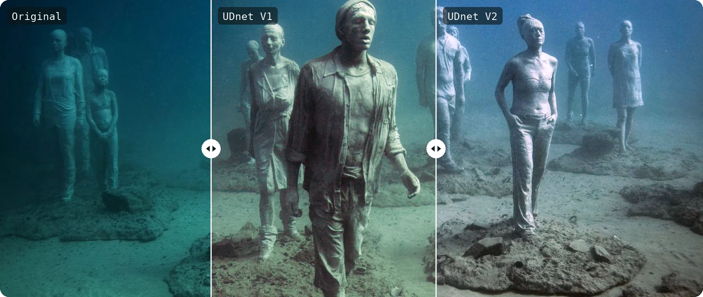
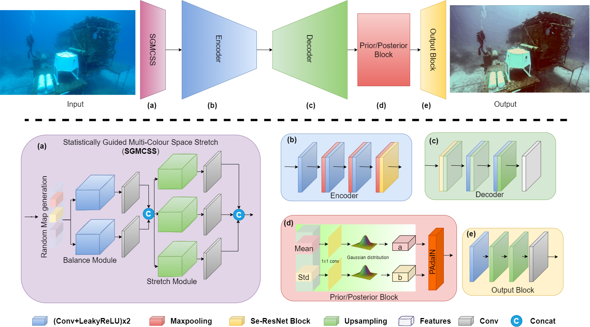

# UDnet

**Underwater image enhancement trained without ground truth.**
UDnet removes the blue–green cast and haze from underwater photos and video frames, at the original resolution.
Official code for *Adaptive deep learning framework for robust unsupervised underwater image enhancement* (Expert Systems with Applications, 2025).

[](https://www.sciencedirect.com/science/article/pii/S0957417424031816)
[](https://huggingface.co/Alzayats/UDnet)
[](https://alzayats.github.io/UDnet/)
[](LICENSE)
[](https://pytorch.org/)

<p align="center">
  <a href="https://alzayats.github.io/UDnet/"></a>
</p>
<p align="center"><sub>Original · UDnet V1 (released, fully unsupervised) · UDnet V2 (preview). Image from UIEB.<br>
<b><a href="https://alzayats.github.io/UDnet/">Open the gallery</a></b> to drag before/after sliders on 24 scenes.</sub></p>

## Models

| Model | Status | Weights | Speed (256×256) | Notes |
|:--|:--|:--|:--|:--|
| **UDnet&nbsp;V1** | Released | [`UDnet.pth`](https://huggingface.co/Alzayats/UDnet)&nbsp;·&nbsp;5.6&nbsp;MB | 457&nbsp;img/s&nbsp;GPU<br>11&nbsp;img/s&nbsp;CPU | Paper model. Fully unsupervised, 1.4 M parameters, runs on a CPU. |
| **UDnet&nbsp;V2** | Preview | [`UDnet_v2.pth`](https://huggingface.co/Alzayats/UDnet)&nbsp;·&nbsp;59&nbsp;MB | 100&nbsp;img/s&nbsp;GPU | Trained on paired images for stronger correction. See the [gallery](https://alzayats.github.io/UDnet/). |
| **UDnet&nbsp;V2&nbsp;+&nbsp;AI** | Preview | V2 + [Real-ESRGAN](https://github.com/xinntao/Real-ESRGAN) | 38&nbsp;img/s&nbsp;GPU | V2 plus an AI detail pass: sharper, 2× upscaled. Can invent fine texture, so it's for viewing, not measurement. |

<sub>Speed: one 256×256 image on an RTX 4090 (CPU: 24 threads), model time only.</sub>

The code exactly as published with the paper is tagged [`v1.0-paper`](https://github.com/alzayats/UDnet/tree/v1.0-paper).

## Quick start

```bash
git clone https://github.com/alzayats/UDnet.git
cd UDnet
pip install -r requirements.txt

python Inference.py --input path/to/images --output results/                    # V1
python Inference.py --input path/to/images --output results/ --model v2         # V2 (preview)
python Inference.py --input path/to/images --output results/ --model v2 --ai x2 # V2 + AI, 2× upscaled
python Inference.py --input dive.mp4 --output results/ --model v2               # a video
```

The weights are downloaded on first run. A GPU is used if available, otherwise the CPU.
Videos (`.mp4`, `.mov`, `.avi`, `.mkv`, `.m4v`) are enhanced frame by frame and written as `.mp4` at
the original frame rate; the audio track is not copied. On an RTX 4090, 1080p video runs at about
9 frames/s with V1 and 5 frames/s with V2.

| Option | Default | |
|---|---|---|
| `--input` | required | an image or video file, or a folder of them |
| `--output` | `results/` | output folder; file names are kept |
| `--model` | `v1` | `v1` (paper model) or `v2` (preview) |
| `--ai` | `none` | `x2` or `x4`: add a Real-ESRGAN detail pass that sharpens and upscales. It can invent fine texture, so use it for viewing, not measurement |
| `--weights` | `weights/UDnet.pth` | any UDnet checkpoint, including ones from `Train.py` (`weights/UDnet_v2.pth` for V2) |
| `--device` | `auto` | `cpu`, `cuda`, `cuda:1`, ... |
| `--format` | `png` | image output: `png`, `jpg`, or `same` as the input |

<details>
<summary><b>Use it from Python</b></summary>

```python
import numpy as np, torch
from PIL import Image
from model_utils.UDnet import load_udnet

model = load_udnet('weights/UDnet.pth', device='cuda')
img = np.asarray(Image.open('photo.jpg').convert('RGB'), dtype=np.float32) / 255
out = model.enhance(torch.from_numpy(img).permute(2, 0, 1)[None].cuda())   # (1, 3, H, W) in [0, 1]
Image.fromarray((out[0].permute(1, 2, 0).cpu().numpy() * 255).round().astype(np.uint8)).save('out.png')
```

For V2, load it with `from model_utils.UDnet_v2 import load_udnet_v2` and
`model = load_udnet_v2('weights/UDnet_v2.pth', device='cuda')`; `model.enhance` works the same way.

</details>

<details>
<summary><b>V2 + AI Max (experimental, separate branch)</b></summary>

The most detailed results in the [gallery](https://alzayats.github.io/UDnet/) add a diffusion-based
detail-restoration stage ([DiffBIR](https://github.com/XPixelGroup/DiffBIR)) after V2. Because it needs
its own environment, about 15 GB of disk, a GPU with about 10 GB of memory and roughly 25 s per image,
it is kept on the [`ai-max`](https://github.com/alzayats/UDnet/tree/ai-max) branch rather than in the
main installation. It can synthesise detail that was not captured, so it is intended for viewing, not
for measurement. Requirements, limitations and licences are described in
[`AI_MAX.md`](https://github.com/alzayats/UDnet/blob/ai-max/AI_MAX.md).

</details>

## Evaluate

<details>
<summary><b>Score results with PSNR, SSIM, UIQM and UCIQE</b></summary>

`evaluate.py` scores a folder of results. With `--ref` it computes PSNR and SSIM against
reference images (matched by file name, any extension); UIQM and UCIQE are always reported.

```bash
python Inference.py --input EUVP/test_samples/Inp --output results/EUVP
python evaluate.py  --pred results/EUVP --ref EUVP/test_samples/GTr --csv results/EUVP.csv
```

Add `--list splits/...txt` to score only the images in a split.

**UDnet v1 on the test sets in [`splits/paper_test`](splits/paper_test)** (50 images each):

| | UIEB | UFO-120 | EUVP | RUIE | Fish-DETRAC | SUIM | DeepFish | FishID |
|---|---|---|---|---|---|---|---|---|
| PSNR ↑ | 18.68 | 18.64 | 19.78 | – | – | – | – | – |
| SSIM ↑ | 0.771 | 0.621 | 0.775 | – | – | – | – | – |
| UIQM ↑ | 2.81 | 3.07 | 3.17 | 2.89 | 2.90 | 2.54 | 2.67 | 1.55 |
| UCIQE ↑ | 0.706 | 0.726 | 0.746 | 0.599 | 0.632 | 0.665 | 0.589 | 0.580 |

UIQM follows the FUnIE-GAN implementation and UCIQE the common OpenCV-Lab version; values from
other implementations are not directly comparable. For UFO-120 the output is upsampled to the
640×480 reference before PSNR/SSIM.

UDnet v1 is fully unsupervised: it never sees a reference image during training, so it is not
trying to reproduce the reference style that PSNR and SSIM reward. UIQM and UCIQE need no reference.

**UDnet V1 and V2 on full held-out test sets** (PSNR ↑ / SSIM ↑ at reference resolution):

| Test set | Images | V1 | V2 (preview) |
|---|---|---|---|
| UIEB [`UIEB/test90`](splits/UIEB/test90.txt) | 90 | 19.86 / 0.842 | 22.86 / 0.909 |
| LSUI [`V2/LSUI_test400`](splits/V2/LSUI_test400.txt) | 400 | 19.64 / 0.807 | 28.07 / 0.910 |
| EUVP `test_samples` | 515 | 19.59 / 0.783 | 25.93 / 0.874 |
| UFO-120 `TEST` | 120 | 18.53 / 0.628 | 24.71 / 0.734 |

V2 is trained on paired images from UIEB and LSUI, which is what these reference-based scores
reward; none of these test images, or near-duplicates of them, were used for training. EUVP and
UFO-120 were not used to train V2 at all. V1 is fully unsupervised (see above).

</details>

## Train

<details>
<summary><b>Train or fine-tune V1 on your own images</b></summary>

UDnet V1 needs only a folder of underwater images. Training targets are generated from each image on the fly.

```bash
python Train.py --train_dir path/to/images                                        # from scratch
python Train.py --train_dir path/to/images --pretrained weights/UDnet.pth --nEpochs 50  # fine-tune
python Train.py --train_dir path/to/images --resume_train True                    # continue a run
python Train.py --train_dir UIEB/raw-890 --train_list splits/UIEB/train800.txt    # use a split
```

Checkpoints go to `weights/`: `epoch_last.pth` every 2 epochs and `epoch_<N>.pth` every `--snapshots` epochs.
See `python Train.py -h` for all options.

</details>

<details>
<summary><b>Train or fine-tune V2 on paired images</b></summary>

V2 is trained on input/reference pairs from [UIEB](https://li-chongyi.github.io/proj_benchmark.html)
(`raw-890`, `reference-890`) and [LSUI](https://lintaopeng.github.io/_pages/UIE%20Project%20Page.html)
(`input`, `GT`), using the lists in [`splits/V2`](splits/V2). It needs a CUDA GPU and a few extra packages.

```bash
pip install kornia lpips tensorboard
python Train_v2.py --uieb path/to/UIEB --lsui path/to/LSUI --name my_v2                  # from scratch
python Train_v2.py --uieb path/to/UIEB --lsui path/to/LSUI --name my_v2 --resume         # continue a run
python Train_v2.py --uieb path/to/UIEB --lsui path/to/LSUI --name ft --init weights/UDnet_v2.pth --iters 20000  # fine-tune
```

The loss combines Charbonnier, SSIM, LPIPS and a frequency-domain term; training uses AdamW with
warm-up and cosine decay, bfloat16 mixed precision and an EMA of the weights. The released
`UDnet_v2.pth` is the EMA model at 80k of the default 100k iterations (the full run takes about 5 hours on an RTX 4090).
Checkpoints go to `weights/v2_runs/<name>/`; use one with `Inference.py --model v2 --weights weights/v2_runs/<name>/best.pth`.

</details>

## Test splits

<details>
<summary><b>Which images are in each test split</b></summary>

Each file in [`splits/`](splits) lists image names, one per line.

| File | Images | Taken from |
|---|---|---|
| `paper_test/UIEB.txt` | 50 | [UIEB](https://li-chongyi.github.io/proj_benchmark.html) as released by [PUIE-Net](https://github.com/zhenqifu/PUIE-Net): `test/image`, reference `test/label/O` |
| `paper_test/UFO120.txt` | 50 | [UFO-120](https://irvlab.cs.umn.edu/resources/ufo-120-dataset) `TEST/lrd`, reference `TEST/hr` |
| `paper_test/EUVP.txt` | 50 | [EUVP](https://irvlab.cs.umn.edu/resources/euvp-dataset) `test_samples/Inp`, reference `test_samples/GTr` |
| `paper_test/RUIE.txt` | 50 | [RUIE](https://github.com/dlut-dimt/Realworld-Underwater-Image-Enhancement-RUIE-Benchmark) `UCCS` |
| `paper_test/DETRAC.txt` | 50 | [Fish-DETRAC](https://github.com/tmandel/fish-detrac) sequence `V1_Leleiwi_26June19_17` |
| `paper_test/SUIM.txt` | 50 | [SUIM](https://irvlab.cs.umn.edu/resources/suim-dataset) |
| `paper_test/DeepFish.txt` | 50 | [DeepFish](https://alzayats.github.io/DeepFish/) |
| `paper_test/FishID.txt` | 50 | FishID |
| `UIEB/train800.txt`, `UIEB/test90.txt` | 800 / 90 | UIEB `raw-890`, fixed random split (seed 0) |
| `V2/UIEB_train.txt` | 738 | V2 training images: `UIEB/train800.txt` without near-duplicates of any test image |
| `V2/LSUI_train.txt`, `V2/LSUI_test400.txt` | 3160 / 400 | [LSUI](https://lintaopeng.github.io/_pages/UIE%20Project%20Page.html); test images chosen by near-duplicate group, training images near-duplicate-free |

</details>

## How it works

<details>
<summary><b>Model design in one paragraph</b></summary>

<p align="center"></p>

Supervised enhancement models need clean reference images, which almost never exist underwater.
UDnet instead builds its own reference for each training image with classical contrast stretching,
refined by a learned multi-colour-space stretch module (SGMCSS). A conditional variational
autoencoder learns from these noisy references, and a probabilistic adaptive instance
normalisation block (PAdaIN) models how uncertain they are. At test time only the image encoder
and decoder run. Details are in the [paper](https://www.sciencedirect.com/science/article/pii/S0957417424031816).

</details>

## Citation

```bibtex
@article{SALEH2025126314,
  title   = {Adaptive deep learning framework for robust unsupervised underwater image enhancement},
  author  = {Alzayat Saleh and Marcus Sheaves and Dean Jerry and Mostafa {Rahimi Azghadi}},
  journal = {Expert Systems with Applications},
  volume  = {268},
  pages   = {126314},
  year    = {2025},
  doi     = {10.1016/j.eswa.2024.126314}
}
```

## License and acknowledgements

MIT license; intended for academic research. UDnet builds on
[PUIE-Net](https://github.com/zhenqifu/PUIE-Net),
[USLN](https://github.com/deepxzy/USLN) and
[PyTorch-Underwater-Image-Enhancement](https://github.com/xueleichen/PyTorch-Underwater-Image-Enhancement).
The UIQM code is adapted from [FUnIE-GAN](https://github.com/xahidbuffon/FUnIE-GAN).
UDnet V2 is built on the [NAFNet](https://github.com/megvii-research/NAFNet) architecture, and the
`--ai` pass uses the official [Real-ESRGAN](https://github.com/xinntao/Real-ESRGAN) weights (BSD-3-Clause),
downloaded from their releases.
