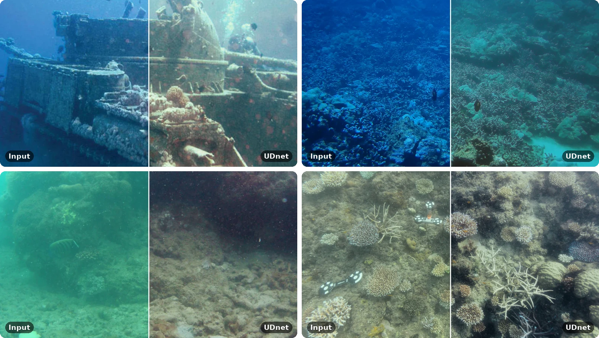

# UDnet

**Underwater image enhancement trained without ground truth.**
UDnet removes the blue–green cast and haze from underwater photos and video frames, at the original resolution.
Official code for *Adaptive deep learning framework for robust unsupervised underwater image enhancement* (Expert Systems with Applications, 2025).

[](https://www.sciencedirect.com/science/article/pii/S0957417424031816)
[](https://huggingface.co/Alzayats/UDnet)
[](https://huggingface.co/spaces/Alzayats/UDnet-demo)
[](LICENSE)
[](https://pytorch.org/)

<p align="center">
  
</p>
<p align="center"><sub>Left half: input. Right half: UDnet output. Images from UIEB, Fish-DETRAC and DeepFish.</sub></p>

## Models

| Model | Status | Weights | Notes |
|---|---|---|---|
| UDnet v1 | Released | [`UDnet.pth`](https://huggingface.co/Alzayats/UDnet) (5.6 MB) | The model from the paper. Unsupervised; 1.4 M parameters. |
| UDnet v2 | In development | – | Will be announced here. |

The code exactly as published with the paper is tagged [`v1.0-paper`](https://github.com/alzayats/UDnet/tree/v1.0-paper).

## Quick start

```bash
git clone https://github.com/alzayats/UDnet.git
cd UDnet
pip install -r requirements.txt

python Inference.py --input path/to/images --output results/
```

The weights are downloaded on first run. A GPU is used if available, otherwise the CPU.
On an RTX 4090, a 1920×1080 image takes about 0.1 s.

| Option | Default | |
|---|---|---|
| `--input` | required | an image or a folder of images |
| `--output` | `results/` | output folder; file names are kept |
| `--weights` | `weights/UDnet.pth` | any UDnet checkpoint, including ones from `Train.py` |
| `--device` | `auto` | `cpu`, `cuda`, `cuda:1`, ... |
| `--format` | `png` | `png`, `jpg`, or `same` as the input |

From Python:

```python
import numpy as np, torch
from PIL import Image
from model_utils.UDnet import load_udnet

model = load_udnet('weights/UDnet.pth', device='cuda')
img = np.asarray(Image.open('photo.jpg').convert('RGB'), dtype=np.float32) / 255
out = model.enhance(torch.from_numpy(img).permute(2, 0, 1)[None].cuda())   # (1, 3, H, W) in [0, 1]
Image.fromarray((out[0].permute(1, 2, 0).cpu().numpy() * 255).round().astype(np.uint8)).save('out.png')
```

## Evaluate

`evaluate.py` scores a folder of results. With `--ref` it computes PSNR and SSIM against
reference images (matched by file name, any extension); UIQM and UCIQE are always reported.

```bash
python Inference.py --input EUVP/test_samples/Inp --output results/EUVP
python evaluate.py  --pred results/EUVP --ref EUVP/test_samples/GTr --csv results/EUVP.csv
```

Add `--list splits/...txt` to score only the images in a split.

**UDnet v1 on the test sets in [`splits/paper_test`](splits/paper_test)** (50 images each):

| | UIEB | UFO-120 | EUVP | RUIE | Fish-DETRAC | SUIM | DeepFish | FishID |
|---|---|---|---|---|---|---|---|---|
| PSNR ↑ | 18.68 | 18.64 | 19.78 | – | – | – | – | – |
| SSIM ↑ | 0.771 | 0.621 | 0.775 | – | – | – | – | – |
| UIQM ↑ | 2.81 | 3.07 | 3.17 | 2.89 | 2.90 | 2.54 | 2.67 | 1.55 |
| UCIQE ↑ | 0.706 | 0.726 | 0.746 | 0.599 | 0.632 | 0.665 | 0.589 | 0.580 |

UIQM follows the FUnIE-GAN implementation and UCIQE the common OpenCV-Lab version; values from
other implementations are not directly comparable. For UFO-120 the output is upsampled to the
640×480 reference before PSNR/SSIM.

## Train

UDnet needs only a folder of underwater images. Training targets are generated from each image on the fly.

```bash
python Train.py --train_dir path/to/images                                        # from scratch
python Train.py --train_dir path/to/images --pretrained weights/UDnet.pth --nEpochs 50  # fine-tune
python Train.py --train_dir path/to/images --resume_train True                    # continue a run
python Train.py --train_dir UIEB/raw-890 --train_list splits/UIEB/train800.txt    # use a split
```

Checkpoints go to `weights/`: `epoch_last.pth` every 2 epochs and `epoch_<N>.pth` every `--snapshots` epochs.
See `python Train.py -h` for all options.

## Test splits

Each file in [`splits/`](splits) lists image names, one per line.

| File | Images | Taken from |
|---|---|---|
| `paper_test/UIEB.txt` | 50 | [UIEB](https://li-chongyi.github.io/proj_benchmark.html) as released by [PUIE-Net](https://github.com/zhenqifu/PUIE-Net): `test/image`, reference `test/label/O` |
| `paper_test/UFO120.txt` | 50 | [UFO-120](https://irvlab.cs.umn.edu/resources/ufo-120-dataset) `TEST/lrd`, reference `TEST/hr` |
| `paper_test/EUVP.txt` | 50 | [EUVP](https://irvlab.cs.umn.edu/resources/euvp-dataset) `test_samples/Inp`, reference `test_samples/GTr` |
| `paper_test/RUIE.txt` | 50 | [RUIE](https://github.com/dlut-dimt/Realworld-Underwater-Image-Enhancement-RUIE-Benchmark) `UCCS` |
| `paper_test/DETRAC.txt` | 50 | [Fish-DETRAC](https://github.com/tmandel/fish-detrac) sequence `V1_Leleiwi_26June19_17` |
| `paper_test/SUIM.txt` | 50 | [SUIM](https://irvlab.cs.umn.edu/resources/suim-dataset) |
| `paper_test/DeepFish.txt` | 50 | [DeepFish](https://alzayats.github.io/DeepFish/) |
| `paper_test/FishID.txt` | 50 | FishID |
| `UIEB/train800.txt`, `UIEB/test90.txt` | 800 / 90 | UIEB `raw-890`, fixed random split (seed 0) |

## How it works

<p align="center"></p>

Supervised enhancement models need clean reference images, which almost never exist underwater.
UDnet instead builds its own reference for each training image with classical contrast stretching,
refined by a learned multi-colour-space stretch module (SGMCSS). A conditional variational
autoencoder learns from these noisy references, and a probabilistic adaptive instance
normalisation block (PAdaIN) models how uncertain they are. At test time only the image encoder
and decoder run. Details are in the [paper](https://www.sciencedirect.com/science/article/pii/S0957417424031816).

## Citation

```bibtex
@article{SALEH2025126314,
  title   = {Adaptive deep learning framework for robust unsupervised underwater image enhancement},
  author  = {Alzayat Saleh and Marcus Sheaves and Dean Jerry and Mostafa {Rahimi Azghadi}},
  journal = {Expert Systems with Applications},
  volume  = {268},
  pages   = {126314},
  year    = {2025},
  doi     = {10.1016/j.eswa.2024.126314}
}
```

## License and acknowledgements

MIT license; intended for academic research. UDnet builds on
[PUIE-Net](https://github.com/zhenqifu/PUIE-Net),
[USLN](https://github.com/deepxzy/USLN) and
[PyTorch-Underwater-Image-Enhancement](https://github.com/xueleichen/PyTorch-Underwater-Image-Enhancement).
The UIQM code is adapted from [FUnIE-GAN](https://github.com/xahidbuffon/FUnIE-GAN).
