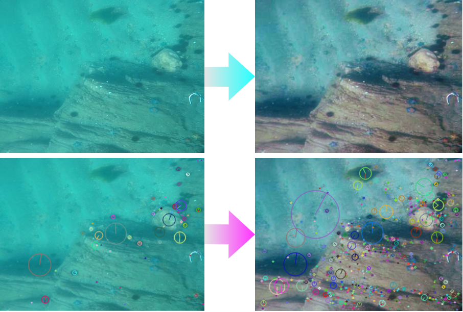

# UDnet: Adaptive deep learning framework for robust unsupervised underwater image enhancement

[](https://www.sciencedirect.com/science/article/pii/S0957417424031816)
[](https://huggingface.co/Alzayats/UDnet)
[](https://opensource.org/licenses/MIT)
[](https://pytorch.org/)

Official PyTorch implementation of **UDnet**, an underwater image enhancement network trained
**without ground-truth images**. Give it a folder of underwater photos and it returns
colour-corrected, higher-contrast versions at the original resolution.

<div align=center></div>

## News
- **2026-10 — v1.1:** easier inference (any image size, automatic weight download, CPU support),
  an evaluation script, published test splits, and training fixes. The released model is unchanged.
  The code exactly as published with the paper is tagged [`v1.0-paper`](https://github.com/alzayats/UDnet/tree/v1.0-paper).

## Quick start

```bash
git clone https://github.com/alzayats/UDnet.git
cd UDnet
pip install -r requirements.txt

python Inference.py --input path/to/your/images --output results/
```

That's it. The pretrained model (5.6 MB) is downloaded from
[Hugging Face](https://huggingface.co/Alzayats/UDnet) on first use and saved to `weights/UDnet.pth`.
A GPU is used automatically when available; otherwise it runs on the CPU.

| Option | Default | Description |
|---|---|---|
| `--input` | (required) | an image file or a folder of images (`png`, `jpg`, `jpeg`, `bmp`, `tif`) |
| `--output` | `results/` | where enhanced images are written, with the same file names |
| `--weights` | `weights/UDnet.pth` | model file; older 62 MB checkpoints and `Train.py` checkpoints also work |
| `--device` | `auto` | `auto`, `cpu`, `cuda`, `cuda:1`, ... |
| `--format` | `png` | `png` (lossless), `jpg`, or `same` as the input |

Images of any size are accepted, and outputs keep the input resolution.
On an RTX 4090 a 1920×1080 image takes about 0.1 s.

### Use it from Python

```python
import numpy as np, torch
from PIL import Image
from model_utils.UDnet import load_udnet

model = load_udnet('weights/UDnet.pth', device='cuda')        # or 'cpu'
img = np.asarray(Image.open('photo.jpg').convert('RGB'), dtype=np.float32) / 255
x = torch.from_numpy(img).permute(2, 0, 1)[None].to('cuda')
out = model.enhance(x)                                      # (1, 3, H, W) in [0, 1]
Image.fromarray((out[0].permute(1, 2, 0).cpu().numpy() * 255).round().astype(np.uint8)).save('out.png')
```

## Evaluation

`evaluate.py` scores a folder of enhanced images. PSNR and SSIM are computed when reference
images are given, and the no-reference metrics UIQM and UCIQE are always computed. Images are
matched by file name, ignoring the extension.

```bash
# paired dataset, e.g. EUVP test samples
python Inference.py --input EUVP/test_samples/Inp --output results/EUVP
python evaluate.py  --pred results/EUVP --ref EUVP/test_samples/GTr --csv results/EUVP.csv

# unpaired dataset: UIQM and UCIQE only
python evaluate.py --pred results/RUIE

# restrict to a split
python evaluate.py --pred results/UIEB --ref UIEB/reference-890 --list splits/UIEB/test90.txt
```

UIQM follows the widely used FUnIE-GAN implementation and UCIQE the common OpenCV-Lab Python
version. Absolute values differ between implementations, so compare methods with the same script.

### Results of the released model

Scores of `weights/UDnet.pth` on the 50-image test sets in [`splits/paper_test`](splits/paper_test),
computed with `evaluate.py`:

| Test set | PSNR ↑ | SSIM ↑ | UIQM ↑ | UCIQE ↑ |
|---|---|---|---|---|
| UIEB | 18.68 | 0.771 | 2.81 | 0.706 |
| UFO-120 | 18.64 | 0.621 | 3.07 | 0.726 |
| EUVP | 19.78 | 0.775 | 3.17 | 0.746 |
| RUIE | – | – | 2.89 | 0.599 |
| Fish-DETRAC | – | – | 2.90 | 0.632 |
| SUIM | – | – | 2.54 | 0.665 |
| DeepFish | – | – | 2.67 | 0.589 |
| FishID | – | – | 1.55 | 0.580 |

For UFO-120 the enhanced 320×240 image is upsampled (bicubic) to the 640×480 reference before computing PSNR/SSIM.

## Training

UDnet is unsupervised: it only needs a folder of underwater images. Training targets are
generated from each input on the fly.

```bash
# train from scratch
python Train.py --train_dir path/to/images

# keep test images out of training with a split file
python Train.py --train_dir UIEB/raw-890 --train_list splits/UIEB/train800.txt

# fine-tune the released model on your own images
python Train.py --train_dir path/to/images --pretrained weights/UDnet.pth --nEpochs 50

# continue an interrupted run (from weights/resume.pth)
python Train.py --train_dir path/to/images --resume_train True
```

Checkpoints are saved to `weights/` (`epoch_last.pth` every 2 epochs and `epoch_<N>.pth` every
`--snapshots` epochs). Use any of them with `Inference.py --weights`. Run `python Train.py -h` for
all options. The training loss uses an ImageNet VGG16, which torchvision downloads on first use.

## Datasets and splits

The [`splits/`](splits) folder lists the exact images used for testing:

| File | Images | Source |
|---|---|---|
| `paper_test/UIEB.txt` | 50 | UIEB as distributed by [PUIE-Net](https://github.com/zhenqifu/PUIE-Net) (`test/image`; reference `test/label/O`) |
| `paper_test/UFO120.txt` | 50 | [UFO-120](https://irvlab.cs.umn.edu/resources/ufo-120-dataset) `TEST/lrd` (reference `TEST/hr`) |
| `paper_test/EUVP.txt` | 50 | [EUVP](https://irvlab.cs.umn.edu/resources/euvp-dataset) `test_samples/Inp` (reference `test_samples/GTr`) |
| `paper_test/RUIE.txt` | 50 | [RUIE](https://github.com/dlut-dimt/Realworld-Underwater-Image-Enhancement-RUIE-Benchmark) `UCCS` |
| `paper_test/DETRAC.txt` | 50 | [Fish-DETRAC](https://github.com/tmandel/fish-detrac) sequence `V1_Leleiwi_26June19_17` |
| `paper_test/SUIM.txt` | 50 | [SUIM](https://irvlab.cs.umn.edu/resources/suim-dataset) |
| `paper_test/DeepFish.txt` | 50 | [DeepFish](https://alzayats.github.io/DeepFish/) |
| `paper_test/FishID.txt` | 50 | FishID |
| `UIEB/train800.txt`, `UIEB/test90.txt` | 800 / 90 | [UIEB](https://li-chongyi.github.io/proj_benchmark.html) `raw-890`, fixed random split (seed 0) |

More underwater datasets: [Awesome Underwater Datasets](https://github.com/xahidbuffon/Awesome_Underwater_Datasets).

## Method

<div align=center></div>

UDnet adapts to the uncertainty distribution of its unsupervised reference maps. A statistically
guided multi-colour space stretch module (SGMCSS) produces a reference map without human
annotation; a U-Net-like conditional variational autoencoder (cVAE) extracts features, and a
Probabilistic Adaptive Instance Normalization (PAdaIN) block encodes their uncertainty to produce
the enhanced image. See the [paper](https://www.sciencedirect.com/science/article/pii/S0957417424031816) for details.

<details>
<summary>Abstract</summary>

One of the main challenges in deep learning-based underwater image enhancement is the limited availability of high-quality training data. Underwater images are often difficult to capture and typically suffer from distortion, colour loss, and reduced contrast, complicating the training of supervised deep learning models on large and diverse datasets. This limitation can adversely affect the performance of the model. In this paper, we propose an alternative approach to supervised underwater image enhancement. Specifically, we introduce a novel framework called Uncertainty Distribution Network (UDnet), which adapts to uncertainty distribution during its unsupervised reference map (label) generation to produce enhanced output images. UDnet enhances underwater images by adjusting contrast, saturation, and gamma correction. It incorporates a statistically guided multicolour space stretch module (SGMCSS) to generate a reference map, which is utilized by a U-Net-like conditional variational autoencoder module (cVAE) for feature extraction. These features are then processed by a Probabilistic Adaptive Instance Normalization (PAdaIN) block that encodes the feature uncertainties for the final image enhancement. The SGMCSS module ensures visual consistency with the input image and eliminates the need for manual human annotation. Consequently, UDnet can learn effectively with limited data and achieve state-of-the-art results. We evaluated UDnet on eight publicly available datasets, and the results demonstrate that it achieves competitive performance compared to other state-of-the-art methods in both quantitative and qualitative metrics.
</details>

## Citation

If you find UDnet useful in your research, please cite:

```bibtex
@article{SALEH2025126314,
  title    = {Adaptive deep learning framework for robust unsupervised underwater image enhancement},
  journal  = {Expert Systems with Applications},
  volume   = {268},
  pages    = {126314},
  year     = {2025},
  issn     = {0957-4174},
  doi      = {https://doi.org/10.1016/j.eswa.2024.126314},
  url      = {https://www.sciencedirect.com/science/article/pii/S0957417424031816},
  author   = {Alzayat Saleh and Marcus Sheaves and Dean Jerry and Mostafa {Rahimi Azghadi}},
  keywords = {Computer vision, Convolutional neural networks, Underwater image enhancement, Variational autoencoder, Machine learning, Deep learning},
}
```

## License
The code is made available for academic research purposes and is open-sourced under the MIT license.

## Credit
https://github.com/zhenqifu/PUIE-Net \
https://github.com/deepxzy/USLN \
https://github.com/xueleichen/PyTorch-Underwater-Image-Enhancement \
UIQM implementation adapted from https://github.com/xahidbuffon/FUnIE-GAN
